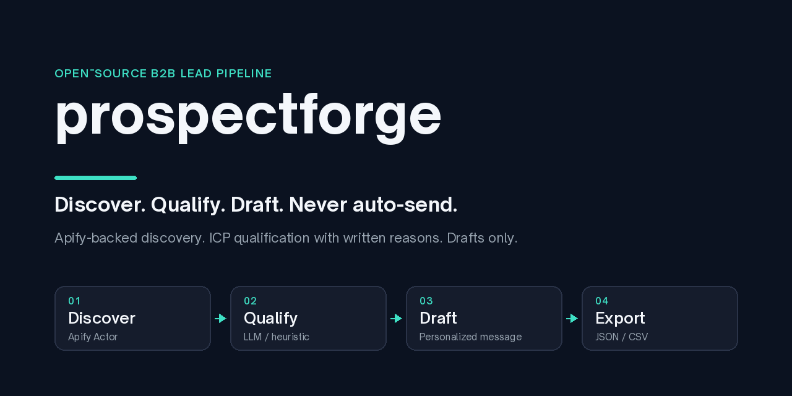
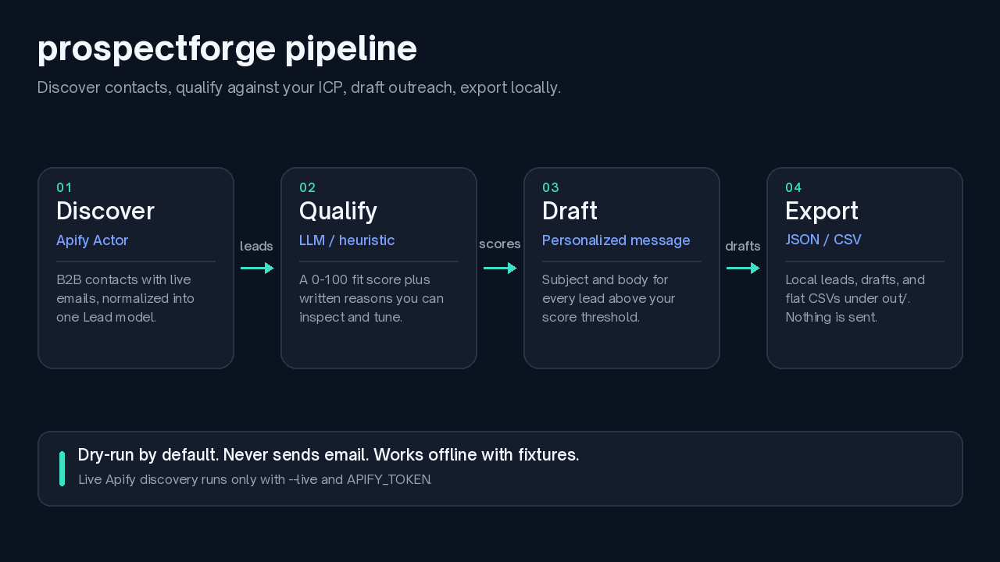

# prospectforge

**Find the right people, understand why they fit, and write the first line — without sending anything.**

`prospectforge` is an open-source B2B lead pipeline. It discovers contacts through maintained Apify Actors, qualifies them against your ideal customer profile (ICP) with written reasons, and drafts personalized outreach. Dry-run by default. It never sends email.

[](LICENSE)
[](pyproject.toml)
[](https://github.com/fluyeporlaweb/prospectforge/actions/workflows/ci.yml)

If this saves you time, a star helps other builders find it.

---

## Why prospectforge exists

Most B2B outreach tools assume you already have a good list, or they hide the judgment step behind a black box. `prospectforge` makes the middle of the pipeline explicit and inspectable.

### vs. uploading a CSV to a sequencer

A sequencer starts after the list exists. It does not help you decide who belongs on the list, why they fit, or what the first line should say. `prospectforge` builds the list, scores each lead, writes down the reasoning, and prepares drafts — then stops. You review before anything leaves your machine.

### vs. a lead database that just dumps rows

Rows are not a strategy. A database can return thousands of contacts without telling you which ones match your ICP or why. `prospectforge` turns a product and an ICP description into a fit score, a verdict, and plain-language reasons per lead. Drafts are only created for leads above your threshold.

### vs. fragile browser scrapers

Browser automation breaks when a page changes, and it often depends on logins, cookies, or anti-bot workarounds. `prospectforge` uses maintained Apify Actors that return structured B2B contact data. Discovery is a normal API-backed run, not a browser session. Raw provider payloads are retained so output drift does not crash the pipeline.

### Inspired by the shape of OpenOutreach

The overall shape — discover, qualify with written reasons, then draft — is inspired by OpenOutreach. We respect that project and its approach. `prospectforge` is an independent implementation that uses maintained Apify Actors for discovery, keeps qualification reasons first-class, and deliberately stops at drafts. It never sends email.

---

## How it works



1. **Discover** — build an ICP-driven input and run a maintained Apify Actor. Normalize the raw items into one `Lead` model.
2. **Qualify** — score each lead from 0 to 100 against your product and ICP. Every score comes with short written reasons.
3. **Draft** — generate a subject and body for each lead above your score threshold. Personalization comes from the lead data you already have.
4. **Export** — write local JSON and CSV files under `out/`. Nothing is sent, queued, or scheduled.

---

## Comparison

| Capability | prospectforge | Typical Apollo-style SaaS | DIY scraping scripts |
| --- | --- | --- | --- |
| Open source | Yes, MIT | No | Usually |
| Auto-sends email | No, never | Often part of the suite | Depends on your script |
| Discovery | Apify-backed Actors | Built-in database | Your own scrapers and proxies |
| ICP qualification | Score + written reasons | Filters and scores, usually opaque | You build it |
| Works offline with fixtures | Yes | No | Only if you build it |
| Dry-run / `--live` safety | Yes | Not applicable | Rarely |
| Credentials needed | Apify token for live discovery; optional LLM key | Account and paid plan | Tokens, cookies, proxies |
| Maintenance | Actor and adapter updates | Vendor-managed | You own breakage |

---

## Quick Start

### 1. Install

```bash
git clone https://github.com/fluyeporlaweb/prospectforge.git
cd prospectforge
python -m venv .venv
. .venv/bin/activate
pip install -e ".[dev]"
prospectforge --help
```

### 2. Dry-run a discovery

See the exact Apify Actor input without spending credits or setting a token:

```bash
prospectforge discover --titles founder --countries es --max 2 --dry-run
```

`discover --dry-run` prints the actor input JSON and exits before contacting Apify.

### 3. Run the pipeline offline

Use the bundled fixture to exercise discovery normalization, qualification, drafting, and export with no network calls:

```bash
prospectforge run \
  --product "A CLI that qualifies B2B leads" \
  --icp "Founders at small software companies in Spain" \
  --input tests/fixtures/leads.json \
  --dry-run \
  --out out/
```

Open `out/leads.json`, `out/leads.csv`, `out/drafts.json`, and `out/drafts.csv`.

---

## Live discovery

Live discovery is explicit. `discover` without `--dry-run` performs an Apify run. `run` without `--input` refuses to start unless you pass `--live`.

```bash
export APIFY_TOKEN="<your-apify-token>"

prospectforge run \
  --product "A CLI that qualifies B2B leads" \
  --icp "Founders at small software companies in Spain" \
  --titles founder \
  --countries es \
  --max 2 \
  --live
```

Or discover only:

```bash
prospectforge discover --titles founder --countries es --max 2
```

Live runs consume Apify credits. `--max` is validated between 1 and 500 and defaults to 25. The default provider is `b2bsearch`; pass `--provider olympus` to use the optional provider.

## Requirements

- Python 3.11 or newer.
- An Apify account for live discovery. [Create one here](https://www.apify.com?fpr=fplw).
- Optional: an OpenAI-compatible API key for LLM qualification and drafting. Without one, deterministic heuristics are used.

The default provider is the [b2bsearch B2B leads finder](https://apify.com/b2bsearch/b2b-leads-finder?fpr=fplw). The optional provider is the [olympus B2B leads finder](https://apify.com/olympus/b2b-leads-finder?fpr=fplw).

Some links above are affiliate links. They support the project at no extra cost to you.

---

## CLI overview

```text
prospectforge [--version] <command>
```

| Command | What it does |
| --- | --- |
| `discover` | Build an ICP-driven Apify input, or run discovery and export leads. |
| `qualify` | Score leads against a product and ICP with written reasons. |
| `draft` | Generate subject and body for qualified leads. Never sends. |
| `run` | Full pipeline: discover or `--input`, qualify, draft, export. |

### Important flags

| Flag | Applies to | Notes |
| --- | --- | --- |
| `--dry-run` | `discover`, `qualify`, `draft`, `run` | No paid calls. `discover` prints the actor input; the pipeline uses heuristics and exports locally. |
| `--live` | `run` | Required to start a real Apify run when `--input` is absent. |
| `--provider` | `discover`, `run` | `b2bsearch` (default) or `olympus`. |
| `--max` | `discover`, `run` | Maximum leads, 1-500, default 25. |
| `--input` | `qualify`, `draft`, `run` | Use a local leads JSON file instead of calling Apify. |
| `--min-score` | `qualify`, `run` | Minimum score for drafting, 0-100, default 60. |
| `--email-type` | `discover`, `run` | `any`, `work`, or `personal` on the default provider. |
| `--out` | all | Output file or directory. `run` defaults to `out/`. |
| `--format` | `discover`, `run` | `json` or `csv`. `run` writes both JSON and CSV. |

Discovery filters include `--titles`, `--countries`, `--departments`, `--seniority`, `--industries`, `--keywords`, `--domains`, `--exclude-domains`, `--cities`, `--exclude-titles`, `--company-size-min`, and `--company-size-max`. Repeat list flags as needed.

```bash
prospectforge discover --help
prospectforge run --help
```

---

## LLM configuration

Set an OpenAI-compatible key to use an LLM for qualification and drafting:

```bash
export OPENAI_API_KEY=...
export OPENAI_BASE_URL=https://api.openai.com/v1   # optional
export PROSPECTFORGE_MODEL=gpt-4o-mini             # optional
```

- `OPENAI_API_KEY` enables the LLM path.
- `OPENAI_BASE_URL` defaults to `https://api.openai.com/v1`.
- `PROSPECTFORGE_MODEL` defaults to `gpt-4o-mini`.
- `--model` overrides the model for a single command.

Without a key — or whenever `--dry-run` is used — `prospectforge` falls back to deterministic heuristics for both qualification and drafting. The result summary reports whether an LLM was used. Malformed LLM JSON triggers one retry, then the heuristic fallback for that lead.

See `.env.example` for the variable names. Never commit a `.env` file or real keys.

---

## Output

`run` writes:

- `leads.json` — the full `PipelineResult`, including leads, qualifications, drafts, and summary.
- `leads.csv` — a flattened lead table.
- `drafts.json` — subject and body per qualified lead.
- `drafts.csv` — the same drafts in flat form.

`discover` writes a leads file, `qualify` writes `qualifications.json`, and `draft` writes `drafts.json` plus `drafts.csv`. All output stays inside the directory you pass to `--out`.

---

## FAQ

### Does it send email?

No. `prospectforge` has no SMTP client, mailbox integration, email API, scheduler, or send button. It produces drafts for you to review and use elsewhere. You are the sender.

### Is it a LinkedIn scraper?

No. Discovery uses B2B contact-database Actors on Apify. `prospectforge` does not scrape LinkedIn, does not use LinkedIn logins, and does not use cookies or browser automation.

### Will a dry run cost money?

No. `discover --dry-run` prints the actor input and exits without contacting Apify. `run`, `qualify`, and `draft` with `--dry-run` skip network calls and LLM requests, so they do not spend Apify credits or API tokens. A live run does consume Apify credits, and LLM calls may consume provider tokens.

### Can I use it completely offline?

Yes. Pass a local leads file with `--input` and use `--dry-run`. The repository fixtures let you run the full pipeline with no credentials and no network.

### Who is responsible for GDPR and outreach compliance?

You are. You are the data controller for the lead data you process and the sender-to-be for any outreach you create. You must comply with applicable law, including the GDPR, the ePrivacy Directive and national implementations such as the LSSI, CAN-SPAM, and the terms of Apify and the underlying data providers. That includes having a lawful basis, providing transparency, honoring objections and opt-outs, minimizing data, and avoiding spam. This project does not provide legal advice.

### Which providers are supported?

`b2bsearch` is the default. `olympus` is optional and may have different coverage, input limits, and email availability. Both are Apify Actors.

### What do I need to describe?

A product description and an ICP description. Optional filter flags narrow the discovery input further.

---

## Roadmap

**v1 (done)**

- Discover, qualify, draft, and export.
- Default and optional Apify providers.
- LLM path plus deterministic heuristic fallback.
- Dry-run by default and an explicit `--live` gate.
- Offline fixtures, JSON/CSV export, tests, and CI.

**Later (possible)**

- CRM export adapters.
- More discovery providers.
- Richer ICP parsing and scoring controls.

No email sending is planned for v1.

---

## Contributing

Contributions are welcome. See [CONTRIBUTING.md](CONTRIBUTING.md) for development setup, the default offline test command, and commit conventions. Please never include tokens, `.env` files, or personal data in issues or pull requests.

## License

MIT. See [LICENSE](LICENSE).

---

## Repository metadata

Suggested description (132 characters or fewer):

> Open-source B2B lead pipeline: discover with Apify, qualify against your ICP, draft outreach. Dry-run by default. No auto-send.

Suggested topics:

`lead-generation` · `b2b` · `outreach` · `apify` · `osint` · `sales` · `cli` · `python` · `open-source` · `apollo-alternative` · `icp` · `email`

The same metadata is kept in [docs/GITHUB.md](docs/GITHUB.md).
